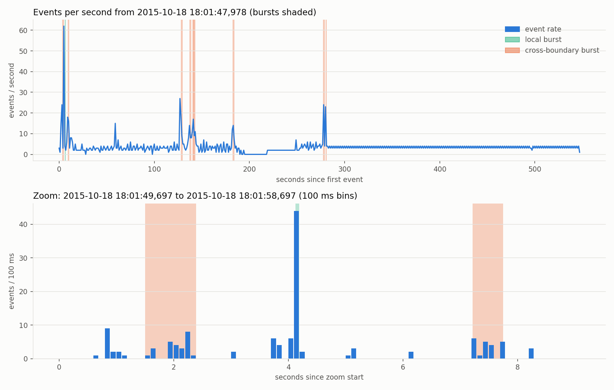

# Hadoop Log Analysis with Divide-and-Conquer Algorithms

---

## 1. Project Description
This project applies three divide and conquer algorithms to the logs of a Hadoop job in order to combine, relate, and scan the logs of separate components for anomalies. The dataset is the Loghub Hadoop collection, which contains 2000 entries across the seven CSV files. The expected outcomes are a single merged timeline, a 7 x 7 dependency matrix, and a count of event bursts for several values of T and M.

Run `python main.py` to write all results to `outputs/`, `python examples.py` for the toy examples, and `python -m pytest tests` for the 23 automated tests.

---

## 2. Algorithms

### 2.1. Distributed K-Way Log Stream Merger Using Divide-and-Conquer

#### 2.1.1. Algorithm Definition
- **Input:** K log streams, each sorted by timestamp, with N entries in total
- **Output:** One stream of all N entries in sorted order, where ties keep the original stream order
- **Problem Statement:** Merge the K streams into one timeline in O(N log K) time while reading the files lazily and holding only O(K) entries in memory

#### 2.1.2. Divide-and-Conquer Design
- **Base Case:** A single stream is already sorted and is returned as is
- **Recursive Strategy:** Split the streams into two halves, merge each half recursively, then join them with a two-way merge. Since there are log K levels and each level does O(N) work, the total is O(N log K)
- **Pseudocode:**
```
KWayMerge(streams[1..K]):
    if K == 1: return streams[1]
    L = KWayMerge(streams[1..K/2])
    R = KWayMerge(streams[K/2+1..K])
    return TwoWayMerge(L, R)        // lazily yields the smaller head, ties go left
```

### 2.2. Strassen's Algorithm for Square Matrix Multiplication of Arbitrary Size

#### 2.2.1. Algorithm Definition
- **Input:** Two n × n matrices A and B, where n can be any size
- **Output:** The product C = A · B
- **Problem Statement:** Compute C with fewer than n³ multiplications. Any n is handled by padding with zeros to the next power of two and cropping the result. Here it is applied to the dependency matrix A, where A[X][Y] = 1 if an event from Y ever immediately follows one from X, so A² and A³ count the two-hop and three-hop walks

#### 2.2.2. Divide-and-Conquer Design
- **Base Case:** Once the size reaches the leaf size, multiply naively
- **Recursive Strategy:** Split each matrix into four quadrants, compute seven products instead of eight, and rebuild C with additions and subtractions. Using the master method, T(n) = 7T(n/2) + O(n²) = O(n^2.81)
- **Pseudocode:**
```
Strassen(A, B):
    pad A and B to size s = next power of two >= n
    if s <= leaf: return Naive(A, B)
    M1 = Strassen(A11 + A22, B11 + B22);  M2 = Strassen(A21 + A22, B11)
    M3 = Strassen(A11, B12 - B22);        M4 = Strassen(A22, B21 - B11)
    M5 = Strassen(A11 + A12, B22);        M6 = Strassen(A21 - A11, B11 + B12)
    M7 = Strassen(A12 - A22, B21 + B22)
    C11 = M1 + M4 - M5 + M7;  C12 = M3 + M5;  C21 = M2 + M4;  C22 = M1 - M2 + M3 + M6
    return top-left n × n block of C
```

### 2.3. Divide-and-Conquer Burst Detection

#### 2.3.1. Algorithm Definition
- **Input:** n sorted timestamps (ms), a span limit T, a minimum event count M, and a base-case size B
- **Output:** The number of non-overlapping bursts and their list
- **Problem Statement:** A burst is at least M consecutive events spanning less than T ms, and no event may belong to more than one burst

#### 2.3.2. Divide-and-Conquer Design
- **Split Burst:** A dense group cut in two by the median split, leaving neither half with M events (similar to split inversions)
  - Only counted in the combine step
  - Must contain events from both sides of the boundary
  - May only use events not already claimed by a burst in either half, so no cluster is counted twice
- **Base Case:** A partition of at most B events is one burst if it has at least M events spanning less than T
- **Recursive Strategy:** Split at the median and recurse on both halves. Like the closest pair strip, the combine step only scans unclaimed events within T of the boundary with a sliding window, so T(n) = 2T(n/2) + O(n) = O(n log n)
- **Pseudocode:**
```
Solve(lo, hi):
    if hi - lo <= B: return 1 burst if (hi - lo >= M and t[hi-1] - t[lo] < T) else 0
    mid = (lo + hi) / 2
    count = Solve(lo, mid) + Solve(mid, hi)
    s = max(last claimed index in left half + 1, first index with t >= t[mid] - T)
    e = min(first claimed index in right half, last index with t <= t[mid] + T)
    i = s; best = 0
    for j = mid .. e:                         // sliding window over the free strip
        while t[j] - t[i] >= T: i += 1
        if i < mid: best = max(best, j - i + 1)   // window must span the boundary
    if best >= M: count += 1
    return count
```

---

## 3. Verification Using Toy Examples

### 3.1. Distributed K-Way Log Stream Merger
```
Input:  A = [1, 5, 9], B = [2, 6], C = [3, 4, 10], D = [7, 8]
Output: [1, 2, 3, 4, 5, 6, 7, 8, 9, 10]     (one entry read per stream before first output)
```
- Split into {A, B} and {C, D}, merged in pairs, then merged together
- Output matches `sorted()` of all inputs
- Only one entry per stream read before the first output, so loading stays lazy

### 3.2. Fault Dependency Analysis Using Strassen's Matrix Multiplication
```
3 × 3 (padded to 4 × 4): [[1,2,0],[0,1,3],[4,0,1]] · [[2,0,1],[1,3,0],[0,1,2]] = [[4,6,1],[1,6,6],[8,1,6]]

Timeline X → Y → Y → Z → X
A           A²          A³
  X Y Z       X Y Z       X Y Z
X 0 1 0     X 0 1 1     X 1 1 1
Y 0 1 1     Y 1 1 1     Y 1 2 1
Z 1 0 0     Z 0 1 0     Z 0 1 1
```
- The 3 × 3 product matches the naive result after padding to 4 × 4
- A³[Y][Y] = 2 because there are exactly two 3-step walks from Y back to itself (Y→Y→Y→Y and Y→Z→X→Y)

### 3.3. Divide-and-Conquer Burst Detection
```
Timestamps: [0, 10, 20, 500, 900, 960, 1010, 1040, 3000, 3500, 4000, 4500],  T = 100, M = 3, B = 4
Result: 2 bursts, local {0, 10, 20} and split burst {960, 1010, 1040}
```
- {0, 10, 20} lies in one partition and is counted once as a local burst
- The median split at 1010 leaves 960 on the left, so only the combine step finds the second burst

---

## 4. Numerical Experiments Using the Target Dataset

### 4.1. Distributed K-Way Log Stream Merger
All 2000 entries were merged in sorted order with at most 7 entries held in memory.

**First 20 merged entries**

| # | Src | Time | Level | Content |
|---|---|---|---|---|
| 1 | p4 | 18:01:47,978 | INFO | Created MRAppMaster for application appattempt_... |
| 2 | p4 | 18:01:48,963 | INFO | Executing with tokens: |
| 3 | p4 | 18:01:48,963 | INFO | Kind: YARN_AM_RM_TOKEN, Service: , Ident: ... |
| 4 | p4 | 18:01:49,228 | INFO | Using mapred newApiCommitter. |
| 5 | p4 | 18:01:50,353 | INFO | OutputCommitter set in config null |
| 6 | p4 | 18:01:50,509 | INFO | OutputCommitter is ...FileOutputCommitter |
| 7 | p4 | 18:01:50,556 | INFO | Registering class ...jobhistory.EventType ... |
| 8 | p4 | 18:01:50,556 | INFO | Registering class ...JobEventType ... |
| 9 | p4 | 18:01:50,556 | INFO | Registering class ...TaskEventType ... |
| 10 | p4 | 18:01:50,556 | INFO | Registering class ...TaskAttemptEventType ... |
| 11 | p4 | 18:01:50,572 | INFO | Registering class ...CommitterEventType ... |
| 12 | p4 | 18:01:50,572 | INFO | Registering class ...Speculator$EventType ... |
| 13 | p4 | 18:01:50,572 | INFO | Registering class ...ContainerAllocator$EventType ... |
| 14 | p4 | 18:01:50,588 | INFO | Registering class ...ContainerLauncher$EventType ... |
| 15 | p4 | 18:01:50,634 | INFO | Default file system [hdfs://msra-sa-41:9000] |
| 16 | p4 | 18:01:50,666 | INFO | Default file system [hdfs://msra-sa-41:9000] |
| 17 | p4 | 18:01:50,713 | INFO | Default file system [hdfs://msra-sa-41:9000] |
| 18 | p4 | 18:01:50,728 | INFO | Emitting job history data to the timeline server is not enabled |
| 19 | p4 | 18:01:50,806 | INFO | Registering class ...JobFinishEvent$Type ... |
| 20 | p4 | 18:01:51,197 | INFO | loaded properties from hadoop-metrics2.properties |

**Last 20 merged entries**

| # | Src | Time | Level | Content |
|---|---|---|---|---|
| 1981 | p1 | 18:10:49,545 | WARN | Address change detected ...:8030 |
| 1982 | p2 | 18:10:50,155 | WARN | Address change detected ...:9000 |
| 1983 | p2 | 18:10:50,155 | WARN | Failed to renew lease ... for 352 seconds |
| 1984 | p1 | 18:10:50,545 | INFO | Retrying connect to server: msra-sa-41:8030 |
| 1985 | p1 | 18:10:50,545 | ERROR | ERROR IN CONTACTING RM. |
| 1986 | p2 | 18:10:51,155 | WARN | Address change detected ...:9000 |
| 1987 | p2 | 18:10:51,155 | WARN | Failed to renew lease ... for 353 seconds |
| 1988 | p1 | 18:10:51,546 | WARN | Address change detected ...:8030 |
| 1989 | p2 | 18:10:52,155 | WARN | Address change detected ...:9000 |
| 1990 | p2 | 18:10:52,155 | WARN | Failed to renew lease ... for 354 seconds |
| 1991 | p1 | 18:10:52,546 | INFO | Retrying connect to server: msra-sa-41:8030 |
| 1992 | p1 | 18:10:52,546 | ERROR | ERROR IN CONTACTING RM. |
| 1993 | p2 | 18:10:53,202 | WARN | Address change detected ...:9000 |
| 1994 | p2 | 18:10:53,202 | WARN | Failed to renew lease ... for 355 seconds |
| 1995 | p1 | 18:10:53,546 | WARN | Address change detected ...:8030 |
| 1996 | p2 | 18:10:54,202 | WARN | Address change detected ...:9000 |
| 1997 | p2 | 18:10:54,202 | WARN | Failed to renew lease ... for 356 seconds |
| 1998 | p1 | 18:10:54,546 | INFO | Retrying connect to server: msra-sa-41:8030 |
| 1999 | p1 | 18:10:54,546 | ERROR | ERROR IN CONTACTING RM. |
| 2000 | p2 | 18:10:55,202 | WARN | Address change detected ...:9000 |

### 4.2. Fault Dependency Analysis Using Strassen's Matrix Multiplication
```
A                         A²                        A³
   p0 p1 p2 p3 p4 p5 p6      p0 p1 p2 p3 p4 p5 p6      p0 p1 p2 p3 p4 p5 p6
p0  1  1  1  1  1  1  0   p0  6  5  5  5  3  5  2   p0 31 28 28 26 14 28 12
p1  1  1  1  1  0  1  0   p1  5  5  5  4  2  5  2   p1 28 26 26 23 11 26 11
p2  1  1  1  0  0  1  0   p2  4  4  4  3  1  4  1   p2 21 20 20 17  8 20  8
p3  1  1  1  1  1  1  1   p3  7  6  6  6  3  6  3   p3 37 34 34 31 16 34 15
p4  1  0  0  1  1  0  0   p4  3  2  2  3  3  2  1   p4 16 13 13 14  9 13  6
p5  1  1  1  1  0  1  1   p5  6  6  6  5  2  6  3   p5 34 32 32 28 13 32 14
p6  1  1  1  1  0  1  1   p6  6  6  6  5  2  6  3   p6 34 32 32 28 13 32 14
```

### 4.3. Divide-and-Conquer Burst Detection
All six cases use B = 32 and count non-overlapping bursts.

| T (ms) | M | Bursts | Local | Split |
|---|---|---|---|---|
| 500 | 10 | 9 | 1 | 8 |
| 1000 | 10 | 10 | 1 | 9 |
| 2000 | 10 | 13 | 3 | 10 |
| 500 | 20 | 4 | 1 | 3 |
| 1000 | 20 | 7 | 1 | 6 |
| 2000 | 20 | 9 | 3 | 6 |



---

## 5. Discussion

### 5.1. Discussion of Distributed K-Way Log Stream Merger Results
- No entries were lost, and only one entry per stream was held at a time
- The first 20 entries all come from p4, which starts the job
- The last 20 alternate between p1 and p2, showing the job ended in a network-failure retry loop
- 1,569 of the 2000 events share a timestamp, so the stable tie rule (left stream wins) keeps the order reproducible

### 5.2. Discussion of Using Strassen's Matrix Multiplication
- A² has no zeros, so every component can reach every other within two hops
- p3 (task state tracking) is the most connected component
- The strongest link is the p1 ↔ p2 loop (282 and 290 transitions), matching the retry loop at the end of the log
- Strassen matched naive multiplication exactly, but padding 7 to 8 gives no savings at this size
- Savings only appear at larger sizes (41% fewer multiplications at n = 128), so the advantage depends on n and how close it is to a power of two

### 5.3. Discussion of Divide-and-Conquer Burst Detection Results
- 9 of the 10 default-case bursts are split bursts, so the combine step is essential
- Raising T or lowering M increases the count, since more groups qualify
- Excluding claimed events keeps the dense start-up spike from being counted as overlapping bursts
- Bursts line up with the job start-up and the two FATAL task deaths at 18:06
- The steady retry loop (about 3.5 events per second) is not flagged, since burst detection only targets sudden spikes

---

## 6. Conclusions

### 6.1. Key Lessons Learned
- Applying divide and conquer and the master method to analyze each recurrence
- Lazy streaming to keep the merge memory-bounded
- Zero padding to extend Strassen to any n
- Handling split cases in the combine step, similar to split inversions and closest pair

### 6.2. Challenges Encountered
- **Counting split bursts once:** The first version let a split burst overlap a burst already found in one half, so a rule was added to only use unclaimed events
- **Choosing T, M, and B:** The burst count is sensitive to all three (B = 16 gives 22 bursts while B = 64 gives 6)
- **Strassen overhead:** Padding and list overhead made Strassen slower than naive in Python at these sizes, so savings were measured by multiplication counts instead

---

## AI Disclaimer
Claude AI was used to helped structure the code after it was provided the pseudocode and wrote the algorithms along with the helper functions. AI was also used to help gather my thoughts and compile the report accordingly. The algorithms and the report were given a thorough review and verified manually.
